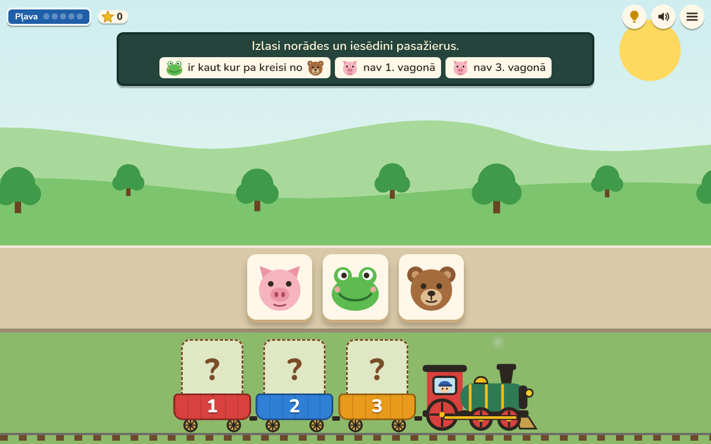

# Tū-tū vilciens / Choo-choo train

Browser logic puzzles for ages 6-9, plus a Very hard tier for adults. Load the right items into
the carriages and the train leaves with a whistle, chuffing and smoke. Latvian by default, with
an English switch.

## Run

Open `index.html` in a browser. No server, build step or network is needed: the font is
embedded, and all pictures and sounds are generated in code.

## How it plays

Drag an item to a carriage, or tap the item and then the carriage. Keyboard works too (Tab,
then Enter). A wrong item bounces back with no penalty. The hint button explains the rule on
the first press and points at one correct move on the second.

Puzzles are generated endlessly. Difficulty goes from level 1 to 20: it rises with clean
solves and eases off when the player struggles. Levels 21 to 30 are the adult tier (see below).
The rating never crosses between the two tiers by itself. Every 5 trains reaches a new station
with new scenery. Progress is saved in `localStorage`, and the menu can change the difficulty or reset.

| Level | New puzzle types |
|---|---|
| 1 | sort by kind, match colour, count |
| 2-3 | shadows, repeating patterns, capital and small letters |
| 4-5 | sums, odd one out, ordering, number sequences |
| 6-7 | clocks, turning and growing picture sequences |
| 8-9 | passenger logic clues, analogies (two trains), mirror images |
| 10-11 | moving-square sequences, 3x3 matrices (three trains) |
| 13 | picture equations |

Each type also gets harder within itself as the level rises.

### Very hard (levels 21-30)

Chosen from the menu, and meant for adults who want to work at it. The train gives no feedback
per item: anything can be loaded, and it is only checked when every carriage is full. A wrong
train is fully unloaded without saying what was wrong, so guessing item by item does not work.
Tap a loaded item to take it back out. Mistakes and hints lower the rating, but it stays in the
tier. The second half of the tier starts at level 25.

| Type | Puzzle | From level 25 |
|---|---|---|
| `shunt` | apply a rearrangement seen on two trains to load a third | 6 carriages, applied twice |
| `overlay` | work out how two grid pictures make the third in each row | the second picture is also turned or flipped |
| `code` | deduce a code from scored attempts | 5 carriages rather than 4 |
| `liar` | seat passengers when exactly one clue is false | 6 passengers rather than 5 |
| `hardseq` | find the last two of eight numbers | tougher rules, such as digit sums and prime steps |
| `system` | solve picture equations using different numbers from 1 to 9 | 4 unknowns rather than 3 |
| `matrix` | 3x3 matrices with 6 choices and the gap anywhere | 4 attributes rather than 3 |

## Code

- `src/puzzles.js`: generators and solution checks, with no DOM
- `src/game.js`: rendering, input, train motion, smoke, progress
- `src/art.js`: all SVG art and scenery
- `src/audio.js`: Web Audio sound synthesis
- `src/i18n.js`: all text, in both languages
- `src/fonts.css`: embedded Nunito (SIL Open Font License)

Scripts are classic rather than ES modules, because modules do not load from `file://`.

## Checking the puzzles

    node tools/check-puzzles.js [puzzlesPerLevelAndType]

Generates puzzles for every type at every level and re-checks them independently: exactly one
solution, no wrong item that also fits, and text present in both languages. For the adult tier
it also tries rival rules, such as other grid operations and number recurrences, and checks that
the false clue in `liar` puzzles does not openly contradict the others.

## Single-file build

    python3 tools/build-single.py OUTPUT.html [--full]

Bundles everything into one file. The default output has no document skeleton, which suits
publishing as an artifact; `--full` makes a complete standalone page.

## Dev aids

`index.html?level=12&type=matrix&seed=7` forces a level, puzzle type and random seed. These
sessions do not touch saved progress. Adding `&dev` exposes `window.__choo` for scripting.
